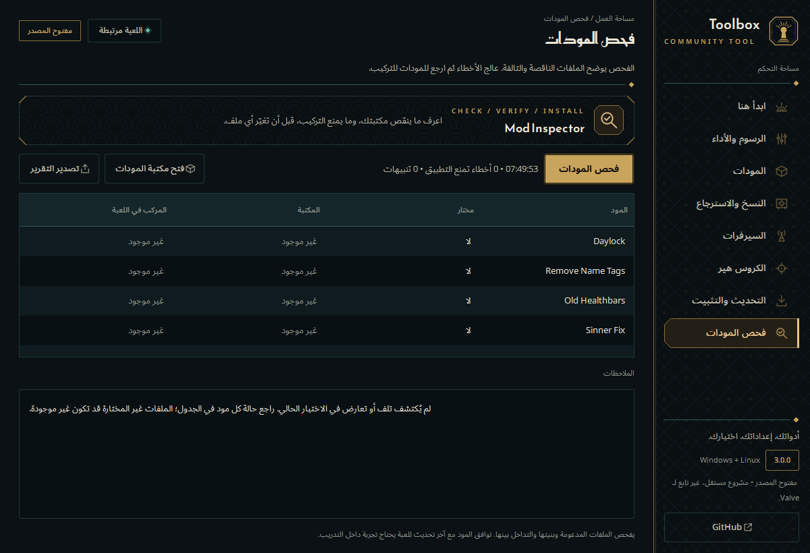
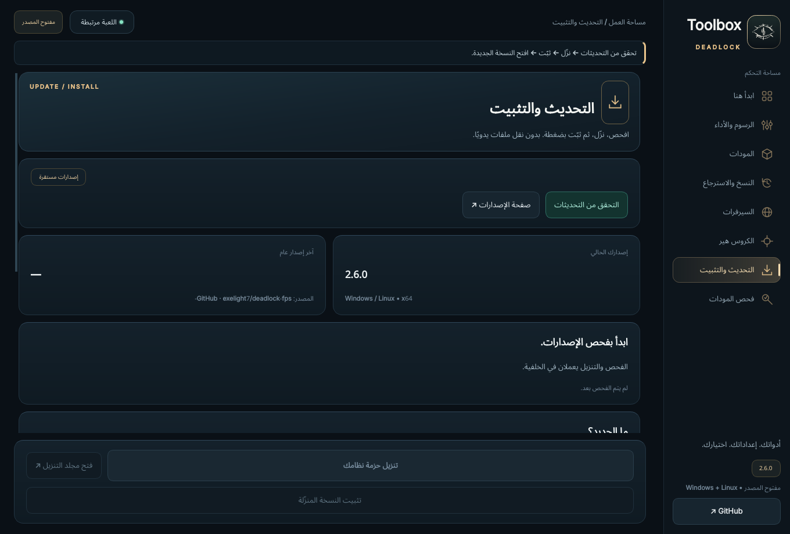

 

<b>خلّ Deadlock أخف، واضبطها على ذوقك.</b> 
الرسوم، المودات، الكروس هير والسيرفرات في برنامج واحد لويندوز ولينكس.

### [⬇ &nbsp;تحميل Windows](https://github.com/exelight7/deadlock-fps-/releases/download/v3.0.0/DeadlockToolbox-windows-x64.zip) &nbsp;&nbsp;◆&nbsp;&nbsp; [⬇ &nbsp;تحميل Linux](https://github.com/exelight7/deadlock-fps-/releases/download/v3.0.0/DeadlockToolbox-linux-x64.zip)

[كل الإصدارات](https://github.com/exelight7/deadlock-fps-/releases) &nbsp;·&nbsp; [ما الجديد في 3.0.0](docs/RELEASE_v3.0.0.md)

 

## ◆ وش تقدر تسوي؟

| | الأداة | وش تسوي |
|:-:|---|---|
|  | **الرسوم والأداء** | خفّف الرسوم بسحاب واحد من 0 إلى 200، مع الحفاظ على دقة اللعبة. عرض الرؤية وحد الإطارات مستقلان. |
|  | **المودات** | اسحب الحزمة، اختر البطاقات، وركّب بتأكيد واحد. الأصل يُحفظ تلقائيًا. |
|  | **فحص المودات** | اعرف الملفات الناقصة والتالفة والتعارضات قبل أن يتغيّر أي ملف. |
|  | **الكروس هير** | صمّم على ذوقك بمعاينة حية، أو ابدأ من 50 تصميمًا جاهزًا وعدّل عليه. |
|  | **السيرفرات** | قارن بنق المناطق، وحدّد ما تفضّله، مع أدوات للحظر وفكّه. |
|  | **النسخ والاسترجاع** | ارجع لملفاتك الأصلية بضغطة، أو صدّر إعداداتك وانقلها. |
|  | **التحديث والتثبيت** | تحقق، نزّل، وثبّت الإصدار الجديد من داخل البرنامج. |

## ◆ ابدأ بثلاث خطوات

1. نزّل نسخة نظامك وفك ضغط المجلد **كاملًا**.
2. افتح `Install.cmd` على Windows، أو شغّل `bash Install.sh` على Linux، ثم افتح التطبيق من قائمة التطبيقات واربطه بمجلد **Deadlock**.
3. أغلق اللعبة، اختر تعديلاتك، ثم راجع وطبّق.

> المودات غير مرفقة؛ أضف حزمك المدعومة من صفحة المودات. جرّب النتيجة في التدريب، خصوصًا عند التخفيف العالي. قياس البنق للمناطق تقريبي وقد يختلف عن بنق المباراة.

## ◆ جولة في الواجهة

<table>
<tr>
<td width="50%"></td>
<td width="50%"></td>
</tr>
<tr>
<td align="center"><b>المودات</b></td>
<td align="center"><b>السيرفرات</b></td>
</tr>
<tr>
<td></td>
<td></td>
</tr>
<tr>
<td align="center"><b>الكروس هير</b></td>
<td align="center"><b>الرسوم والأداء</b></td>
</tr>
<tr>
<td></td>
<td></td>
</tr>
<tr>
<td align="center"><b>فحص المودات</b></td>
<td align="center"><b>التحديث والتثبيت</b></td>
</tr>
</table>

## ◆ الهوية

حبر أسود، أزرق مخضر داكن، ونحاس معتّق بروح آرت ديكو نيويورك الثلاثينيات. كل الأيقونات والرسوم أصلية ومرسومة بالكود من `scripts/make_assets.py`، والخطوط حرة (Reem Kufi و Noto Sans). لا تُستخدم شعارات أو رسومات Valve.

[دليل التصميم](docs/DESIGN.md) · [لوحة الأصول](docs/contact-sheet.png)

## ◆ تحتاج مساعدة؟

[تركيب المودات](docs/MOD_INSTALL.md) · [فحص المودات](docs/MOD_INSPECTOR.md) · [الكروس هير](docs/CROSSHAIR_GUIDE.md) · [التحديثات](docs/UPDATE_CENTER.md)

معلومات إضافية

 

يعمل على Windows وLinux بمعمارية x64. للتحديث من 2.5 وما بعده: التحديث والتثبيت ← تحقق ← نزّل ← ثبّت. القادم من إصدار أقدم يفك الحزمة كاملة ويشغّل ملف التثبيت مرة واحدة. في Linux قد تحتاج إعادة تطبيق حظر السيرفرات بعد إعادة التشغيل؛ أدوات السيرفرات تحتاج `ping` و`iptables` وpolkit.

الكود مفتوح المصدر ويمكنك تعديله. [البناء من المصدر](docs/BUILD.md) · [ترخيص الكود](LICENSE) · [حقوق المحتوى](THIRD_PARTY.md).

 

مشروع مستقل من المجتمع، غير تابع لـ Valve. أسماء Deadlock و Steam ملك لأصحابها.

