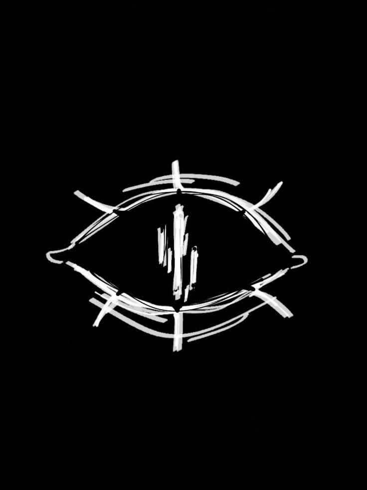
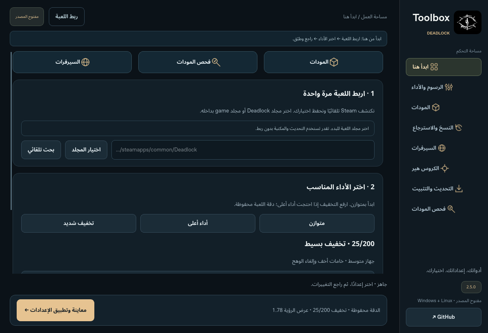

# Deadlock Toolbox

خلّ Deadlock أخف، واضبطها على ذوقك. الرسوم، المودات، الكروس هير والسيرفرات في برنامج واحد لويندوز ولينكس.

**[تحميل Windows](https://github.com/exelight7/deadlock-fps-/releases/download/v2.4.0/DeadlockToolbox-windows-x64.zip)** · **[تحميل Linux](https://github.com/exelight7/deadlock-fps-/releases/download/v2.4.0/DeadlockToolbox-linux-x64.zip)** · [آخر الإصدارات](https://github.com/exelight7/deadlock-fps-/releases)

## وش تقدر تسوي؟

- **خفّف الرسوم** بسحاب واحد، مع الحفاظ على دقة اللعبة.
- **ركّب المودات** بالسحب والإفلات، وافحص الملفات الناقصة والتالفة والتعارضات قبل التركيب.
- **صمّم Crosshair** على ذوقك أو اختر من 50 تصميمًا جاهزًا وعدّل عليه.
- **قارن اتصال المناطق** وحدّد السيرفرات التي تفضّلها، مع أدوات للحظر وفكّه.
- **نزّل التحديثات** من داخل البرنامج، واسترجع ملفاتك الأصلية عند الحاجة.

## ابدأ بثلاث خطوات

1. نزّل نسخة نظامك وفك ضغط المجلد **كاملًا**.
2. افتح البرنامج واربطه بمجلد **Deadlock**.
3. أغلق اللعبة، اختر تعديلاتك، ثم راجع وطبّق.

المودات غير مرفقة؛ أضف حزمك المدعومة من صفحة المودات. جرّب النتيجة في التدريب، خصوصًا عند التخفيف العالي. قياس البنق للمناطق تقريبي وقد يختلف عن بنق المباراة.

## تحتاج مساعدة؟

[تركيب المودات](docs/MOD_INSTALL.md) · [فحص المودات](docs/MOD_INSPECTOR.md) · [Crosshair](docs/CROSSHAIR_GUIDE.md) · [التحديثات](docs/UPDATE_CENTER.md)

معلومات إضافية

يعمل على Windows وLinux بمعمارية x64. عند التحديث، أغلق النسخة القديمة وفك الحزمة الجديدة كاملةً. في Linux قد تحتاج إعادة تطبيق حظر السيرفرات بعد إعادة التشغيل؛ أدوات السيرفرات تحتاج `ping` و`iptables` وpolkit.

الكود مفتوح المصدر ويمكنك تعديله. [البناء من المصدر](docs/BUILD.md) · [ترخيص الكود](LICENSE) · [حقوق المحتوى](THIRD_PARTY.md).

مشروع مستقل من المجتمع، غير تابع لـ Valve.

