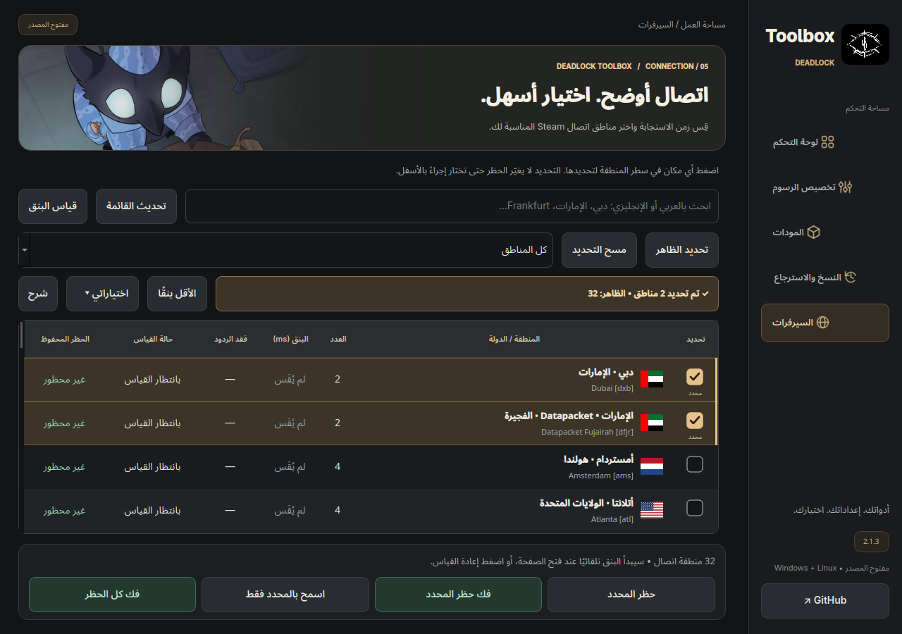

<div dir="rtl">

# Deadlock Toolbox

**الجديد في 2.2.2:** واجهة Crosshair Designer بالإنجليزي، تصميم جديد بتبويبات Shape / Outline / Behavior، ومعرض PRO Crosshairs يحتوي 50 تصميمًا مع بحث وفلترة حسب الشكل، وتطبيق مع نسخ احتياطي. [دليل المصمم](docs/CROSSHAIR_GUIDE.md) • [مصادر إعدادات اللاعبين](docs/CROSSHAIR_SOURCES.md).

برنامج مكتبي مفتوح المصدر لتخصيص Deadlock على **Windows وLinux**: تخفيف الرسوم، تركيب المودات، اختيار مناطق اتصال Steam، والنسخ الاحتياطي. واجهة عربية بتصميم فحمي وذهبي. **يحافظ على دقة الشاشة والعرض الداخلي وإعدادات FSR/DLSS.**


## تحميل الإصدار 2.2.2

- [Windows x64 — ZIP](https://github.com/exelight7/deadlock-fps-/releases/download/v2.2.2/DeadlockToolbox-windows-x64.zip)
- [Linux x64 — ZIP](https://github.com/exelight7/deadlock-fps-/releases/download/v2.2.2/DeadlockToolbox-linux-x64.zip)
- [كل الإصدارات والتحقق من SHA256](https://github.com/exelight7/deadlock-fps-/releases)

فك ضغط الحزمة **كاملًا**، ثم افتح `DeadlockToolbox.exe` على Windows أو `DeadlockToolbox` على Linux. ملفات Qt ومجلد `_internal` ضرورية. حزمة Windows غير موقعة رقميًا. Linux يحتاج مكتبات Qt المكتبية؛ هذه حزمة محمولة وليست AppImage.

## الرسوم والمودات

1. شغّل Deadlock مرة واحدة لإنشاء إعدادات الفيديو، ثم أغلقها.
2. افتح Toolbox؛ يكتشف Steam تلقائيًا، أو اختر مجلد اللعبة وحدد حسابك.
3. حرّك مستوى التخفيف من **0 إلى 200**. الأساسي **80** عنيف من الملفات المرجعية: الرقم الأقل للجودة الأعلى، والأعلى لرسوم أبسط وحمل أقل.
4. عرض الرؤية مستقل: **1.78–3.50**، وحد الإطارات مستقل أيضًا.
5. اضغط **معاينة وتطبيق**، راجع الفروقات، ثم طبّق. يُحفظ الأصل تلقائيًا.
6. صفحة المودات تستورد ZIP أو VPK أو مجلدًا، وتتعرف على الحزم المعروفة بمحتواها. اختيار مود ثم تركيبه لا يغيّر مستوى الرسوم.

تتدرج الخامات والظلال والضباب والتظليل والجزيئات مع المستوى. عند 175 تخف حسابات حجب الصوت، وعند 200 تقل الجزيئات الفيزيائية؛ هذه مستويات تجريبية قد تؤثر على وضوح بعض المؤثرات. **لا توجد زيادة FPS مضمونة.** جرّب الوضوح في التدريب بعد التطبيق. دعم خيارات المحرك والمودات يعتمد على إصدار اللعبة.

Remove Name Tags وOld Healthbars متعارضان؛ اختيار أحدهما يلغي الآخر. **حزم VPK غير مرفقة بالتنزيل**؛ استورد ملفاتك. التركيب في `game/citadel/fps_studio` مع مسار تحميل خاص، دون حذف موداتك الخارجية.

## السيرفرات



- أعلام محلية وأسماء عربية وإنجليزية. دبي والفجيرة في أول القائمة، والبحث يدعم اللغة العربية ورمز المنطقة.
- اضغط سطر المنطقة أو مربعها لتحديدها. يظهر السطر ذهبيًا مع ✓ وكلمة «محدد» وتنبيه بالعدد. التحديد وحده لا يطبّق الحظر ولا يخفي بقية القائمة.
- «تحديد الظاهر» يحدد نتائج البحث؛ البحث لا يلغي الاختيارات خارج النتائج. يمكن عرض كل المناطق، أو الحظر المحفوظ، أو المحددة فقط.
- أزرار ثابتة لـ **حظر المحدد، فك حظر المحدد، اسمح بالمحدد فقط، فك كل الحظر**. لا يحتاج فك الكل إلى تحديد مناطق.
- يبدأ قياس البنق عند فتح الصفحة. يمكن إعادة القياس وترتيب النتائج وحفظ الاختيارات.

**البنق المعروض قياس ICMP إلى خوادم Steam الوسيطة، وليس بنق المباراة.** «لا رد» قد تعني أن ICMP محجوب؛ لا تعني توقف سيرفر اللعبة. عند فشل العنوان الأول تُجرّب عناوين إضافية. أخطاء الأداة لا تُعرض كفقد وهمي 100%. تفاصيل السبب متاحة عند المرور على النتيجة.

أغلق اللعبة قبل تطبيق الحظر، وراجع التأكيد ثم نافذة صلاحية المدير. الاختيار لا يضمن منطقة المباراة، وقد يؤثر الحظر على ألعاب Steam الأخرى التي تشارك العناوين. حالة الجدول هي **الاختيار المحفوظ، وليست فحصًا حيًا لجدار الحماية**. في Linux أعد التطبيق بعد إعادة التشغيل. Toolbox يزيل قواعده الخاصة فقط؛ قواعد ServerPickerX السابقة تُزال من البرنامج الأصلي.

Linux يحتاج `ping` للقياس، و`iptables` و`iptables-restore` وpolkit للتطبيق. Windows يستخدم PowerShell وnetsh. الرسوم والمودات لا تحتاج صلاحية مدير. راجع [تفاصيل تنفيذ السيرفرات](docs/SERVER_PICKER_INTEGRATION.md).

## إصلاح رجوع الإعدادات والاسترجاع

يقارن البرنامج قيم التعديلات، ويتقبل اختلاف تنسيق الأرقام أو تغيّر الإعدادات غير المُدارة. الإصلاح يدمج قيم التخفيف مع الملفات الحالية بدل استبدال `gameinfo.gi` بقالب قديم. يُحفظ الوضع الحالي قبل الإصلاح.

للحماية التلقائية أبقِ البرنامج مفتوحًا: ينتظر استقرار الملفات وإغلاق اللعبة، ثم يصلح القيم. لا يكتب أثناء اللعب، ولا يقفل ملفات Steam أو يعطل تحديثاته. إذا تكرر رفض القيم، يوقف المحاولات المتكررة ويعرض الحالة. لا يمكن ضمان قبول كل متغير بعد تحديثات اللعبة.

النسخ في `Deadlock/.deadlock-fps-studio/`؛ لا تحذف هذا المجلد إذا احتجت الاسترجاع. الاسترجاع يعطّل الحماية ويحتفظ بإعدادات الدقة الحالية. ملفات JSON القديمة مقبولة؛ تُتجاهل قيم تغيير الدقة القديمة. إعدادات عرض الرؤية مستقلة وتبقى محفوظة عند تحريك مستوى التخفيف.

## جديد في 2.1.3

دمج أدوات السيرفرات في Deadlock Toolbox، تصميم وصور تتبدل بين الأقسام، أعلام وأسماء أوضح، وتحديد مرئي ثابت أثناء تحديث البنق والترتيب. أُزيل زر «اختيار دبي» الذي كان يملأ البحث تلقائيًا ويخفي بقية المناطق. أُصلحت إزالة حظر Windows بالاسم الذي تنشئه أداة netsh.

</div>

## Build from source

```sh
python -m venv .venv
# Linux: . .venv/bin/activate
# Windows: .venv\Scripts\activate
python -m pip install -r requirements.txt pyinstaller==6.20.0
python -m unittest discover -s tests -v
python main.py
python build.py
python scripts/smoke_desktop.py
```

Build on the target OS with Python 3.12. `run-linux.sh` and `run-windows.bat` also run from source. Outputs go in `dist/`. CI tests both platforms, checks the built portable GUI, and runs a real scoped firewall smoke test on its disposable Windows runner. Publishing requires the explicitly marked release commit; ordinary pushes and manual runs only test and build.

Application source is MIT. The selected artwork, Valve data, reference configs, mods and dependencies retain their own rights; the source license does not relicense them. See [THIRD_PARTY.md](THIRD_PARTY.md) and [artwork sources](assets/artwork/SOURCES.md). This is an independent community utility, not a Valve product.
