

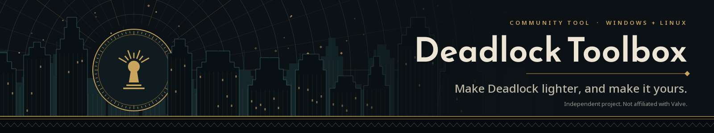

 

**Make Deadlock lighter, and make it yours.** 
Graphics, mods, crosshair and servers in one app for Windows and Linux.

### [⬇ &nbsp;Download for Windows](https://github.com/exelight7/deadlock-fps-/releases/download/v3.5.5/DeadlockToolbox-windows-x64.zip) &nbsp;&nbsp;◆&nbsp;&nbsp; [⬇ &nbsp;Download for Linux](https://github.com/exelight7/deadlock-fps-/releases/download/v3.5.5/DeadlockToolbox-linux-x64.zip)

[All releases](https://github.com/exelight7/deadlock-fps-/releases) &nbsp;·&nbsp; [What's new in 3.5.5](docs/RELEASE_v3.5.5.md) &nbsp;·&nbsp; [العربية](#-بالعربية)

 

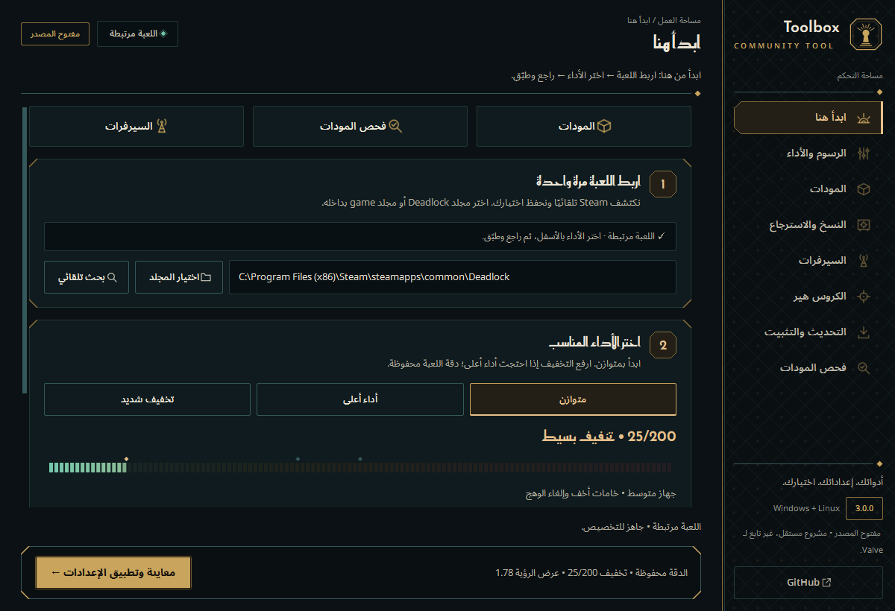

## ◆ What it does

| | Tool | What you get |
|:-:|---|---|
| 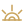 | **Home** | Finds Deadlock on your PC by itself and shows the state of every tool at a glance. |
| 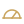 | **Performance** | One slider from 0 to 200 lightens the graphics while your resolution stays untouched. View width and frame limit are separate. |
|  | **Crosshair** | Design your own with a live preview, or start from 50 ready designs. |
|  | **Mods** | Drop a bundle, pick the cards, install with one confirmation. Inspection for missing, damaged and conflicting files is one tab away. |
| 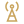 | **Servers** | Compare ping per region and block or allow the regions you choose. |
|  | **Recovery** | One place to undo graphics, crosshair, mods and server blocks, and to export your settings. |
|  | **Settings** | Language (English or Arabic), settings guard and update checks. |

## ◆ Start in three steps

1. Download the package for your system and extract the **whole** folder.
2. Open `Install.cmd` on Windows, or run `bash Install.sh` on Linux, then open the app from your app menu. It looks for **Deadlock** on its own; if it cannot find it, it tells you why and lets you pick the folder.
3. Close the game, choose your changes, then review and apply.

> Mods are not bundled; add your supported bundles on the Mods page. Test the result in training, especially at high reduction levels. Region ping is an estimate and can differ from match ping.

## ◆ A look around

<table>
<tr>
<td width="50%">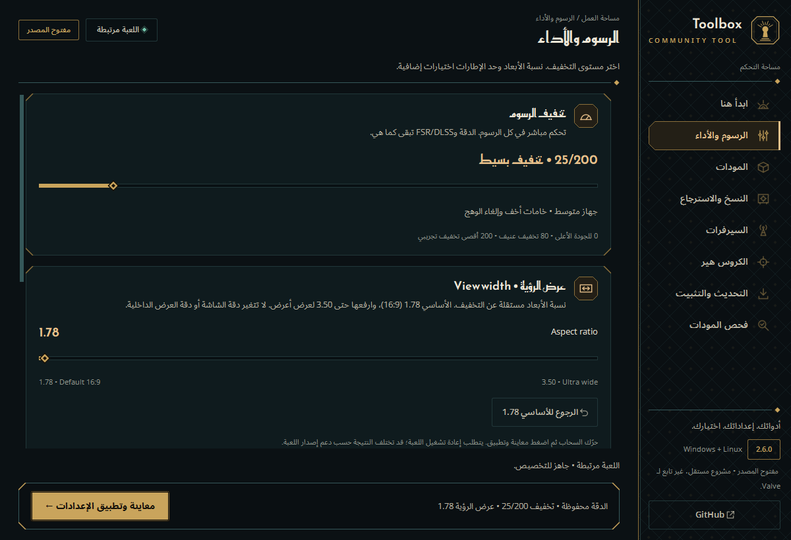</td>
<td width="50%">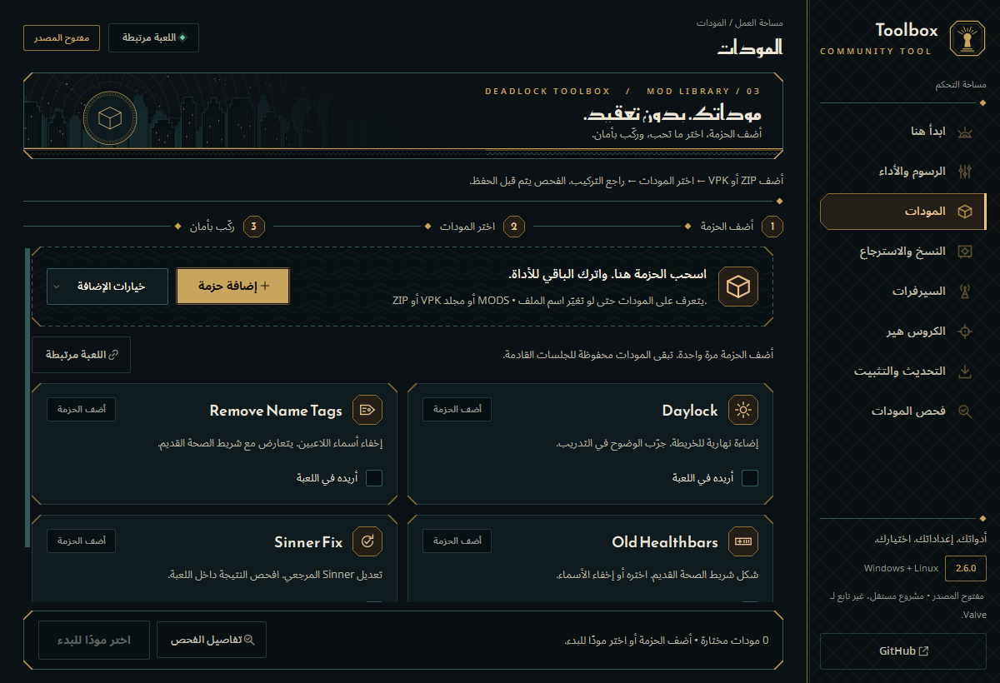</td>
</tr>
<tr><td align="center"><b>Performance</b></td><td align="center"><b>Mods</b></td></tr>
<tr>
<td>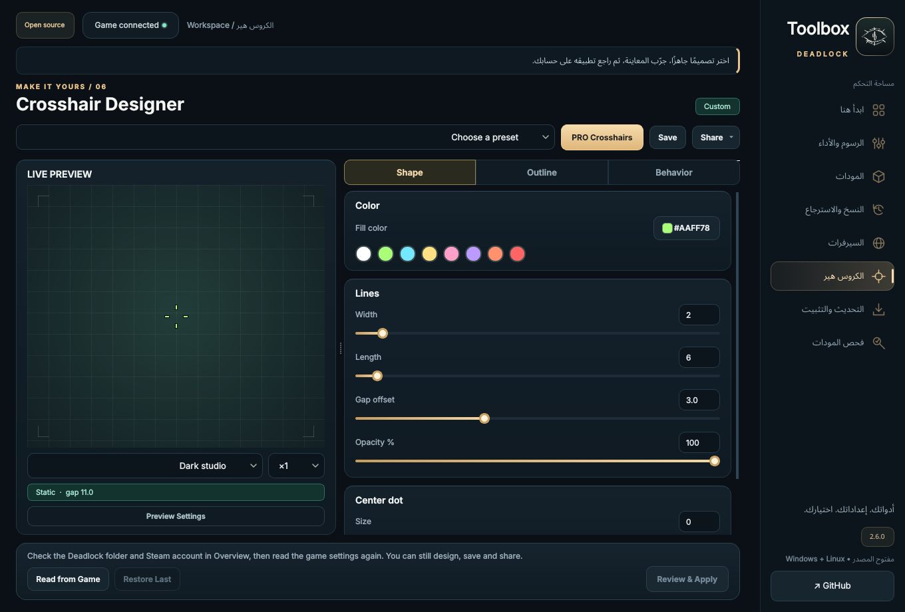</td>
<td>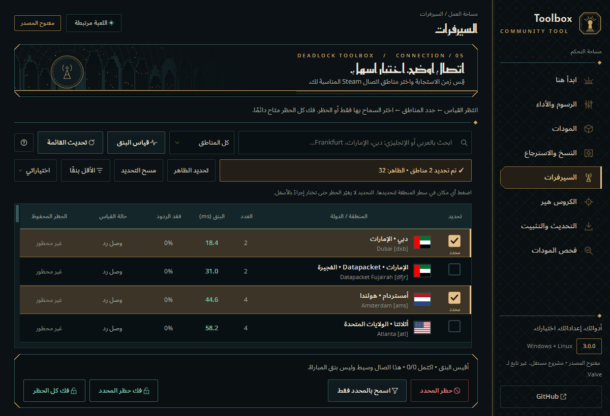</td>
</tr>
<tr><td align="center"><b>Crosshair</b></td><td align="center"><b>Servers</b></td></tr>
<tr>
<td>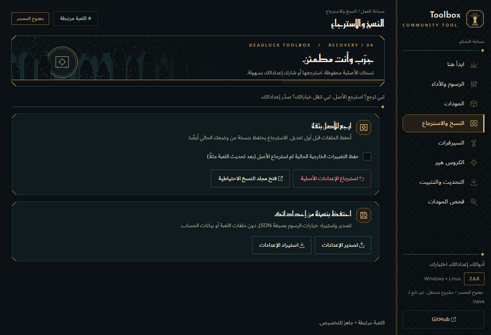</td>
<td>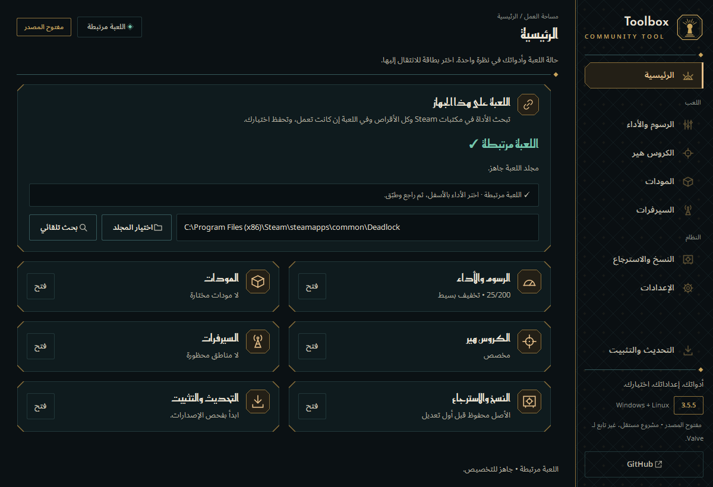</td>
</tr>
<tr><td align="center"><b>Recovery</b></td><td align="center"><b>العربية · Arabic, right-to-left</b></td></tr>
</table>

## ◆ Identity

Ink black, dark teal and aged brass in the spirit of 1930s art-deco New York. Every icon and illustration is original and drawn by code in `scripts/make_assets.py`; the fonts are free (Reem Kufi, Noto Sans). No Valve logos or artwork are used.

[Design brief](docs/DESIGN.md) · [Asset contact sheet](docs/contact-sheet.png)

## ◆ Help and details

[Installing mods](docs/MOD_INSTALL.md) · [Mod inspector](docs/MOD_INSPECTOR.md) · [Crosshair](docs/CROSSHAIR_GUIDE.md) · [Updates](docs/UPDATE_CENTER.md) · [Build from source](docs/BUILD.md)

More

 

Runs on Windows and Linux, x64. Updating from 2.5 or later: Updates → Check → Download → Install. From older versions, extract the whole package and run the installer once. On Linux you may need to apply server blocks again after a reboot; the server tools need `ping`, `iptables` and polkit.

The guides in `docs/` are written in Arabic. The code is open source: [code license](LICENSE) · [third-party content](THIRD_PARTY.md).

## ◆ بالعربية

**خلّ Deadlock أخف، واضبطها على ذوقك.** الرسوم، المودات، الكروس هير والسيرفرات في برنامج واحد لويندوز ولينكس، بواجهة إنجليزية وعربية تختارها من **الإعدادات**.

- **الرئيسية:** تكتشف اللعبة في جهازك تلقائيًا وتعرض حالة كل أداة.
- **الأداء:** سحاب واحد من 0 إلى 200 يخفف الرسوم ويحافظ على دقة اللعبة.
- **الكروس هير:** صمّم بمعاينة حية أو ابدأ من 50 تصميمًا جاهزًا.
- **المودات:** اسحب الحزمة، اختر، وركّب بتأكيد واحد، والفحص في تبويب بجانبها.
- **السيرفرات:** قارن البنق وحدّد المناطق التي تفضّلها.
- **الاسترجاع:** مكان واحد للتراجع عن كل شيء.

**البداية:** نزّل حزمة نظامك وفك المجلد كاملًا، شغّل `Install.cmd` على Windows أو `bash Install.sh` على Linux، ثم أغلق اللعبة، اختر تعديلاتك، وراجع وطبّق.

 

An independent community project, not affiliated with Valve. Deadlock and Steam belong to their owners. مشروع مستقل من المجتمع، غير تابع لـ Valve.

