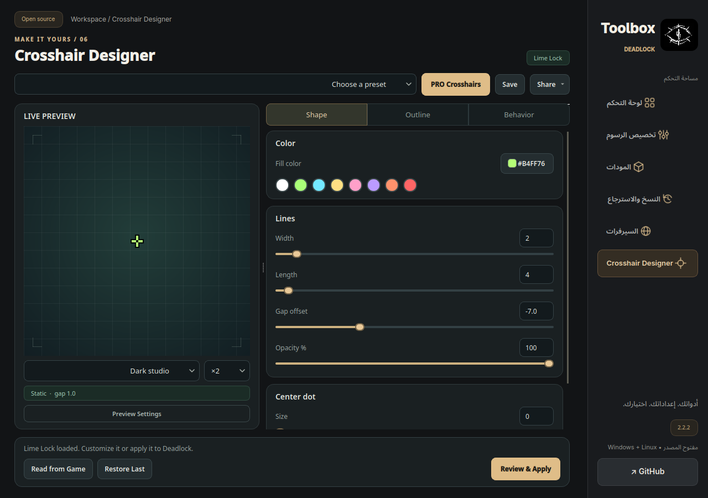
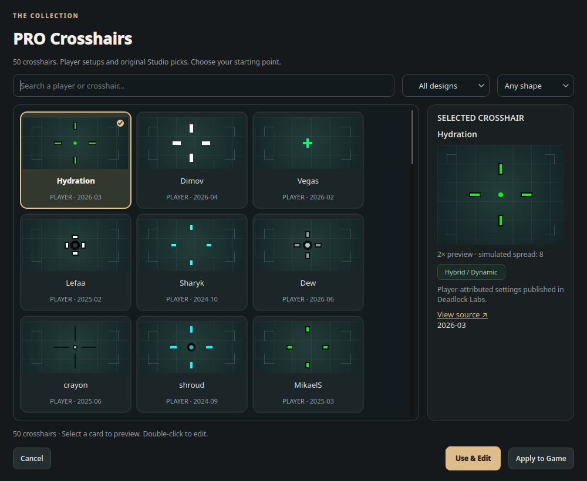

# Crosshair Designer — 2.2.2

المصمم جزء من Deadlock Toolbox 2.2.2 على Windows وLinux. حزم النظامين تُبنى وتُختبر عبر GitHub Actions، ويُتاح الإصدار بعد نجاح البناء والفحوص.

1. أغلق نسخة Toolbox السابقة وافتح اختصار Deadlock Toolbox من سطح المكتب؛ يبدأ مباشرة في Crosshair Designer.
2. واجهة المصمم ونافذة PRO Crosshairs باللغة الإنجليزية. قسم Shape للألوان والخطوط والنقطة، وOutline للحدود، وBehavior للحركة وتفضيلات الأبطال. بقية صفحات البرنامج تحتفظ بلغتها الحالية، وتصاميمك المحفوظة تحتفظ بأسمائها.
3. يحتوي PRO Crosshairs على 50 تصميمًا: 9 إعدادات منشورة منسوبة للاعبين وصناع محتوى، و41 تصميمًا أصليًا من Toolbox، منها 36 إضافة جديدة. ليست التصاميم الأصلية إعدادات منسوبة لمحترفين. ابحث بالاسم أو اختر Player setups / Studio picks، ثم رشّح الشكل Cross / Dot / Ring / Hybrid. المصادر والتواريخ مع إعدادات اللاعبين وفي [سجل المصادر](CROSSHAIR_SOURCES.md).
4. اضغط البطاقة لمعاينتها؛ الإطار الذهبي وعلامة الاختيار يوضحان التصميم المحدد. Use & Edit يحمّل القيم في المحرر، وApply to Game يفتح مراجعة الحفظ مباشرة. النقر المزدوج يفتح التصميم للتعديل. يمكن تعديل جميع التصاميم.
5. تبدأ المعاينة عند 1×، وتقرأ ارتفاع اللعبة لضبط الحجم المرجعي دون تغيير دقتها. التكبير 2×–8× للتفاصيل فقط. Preview Settings يفتح ضبط ارتفاع المعاينة والتوسّع التجريبي دون تضييق النافذة. التوسّع لا يقرأ حالة سلاحك الحية ولا يغيّر ملفات اللعبة. Make Static يجهّز خطوطًا ثابتة ويوقف العلامات الخاصة بالأبطال، ثم يحتاج التطبيق المعتاد.
6. Save يحفظ التصميم باسم محليًا، وShare يتيح رمز Toolbox الذي يبدأ بـ DLTB1. هذا الرمز خاص بالمصمم وليس كود DL للصقه في Deadlock. يمكن استيراد/تصدير JSON أيضًا.
7. أغلق اللعبة واضغط Review & Apply. راجع الملفات والفروقات ثم اضغط Apply & Back Up. بعد ذلك شغّل اللعبة واختبره في التدريب. Restore Last يعرض الفروقات ويعيد الحقول التي غيّرها المصمم مع الحفاظ على الإعدادات الأخرى.

## التوافق والنسخ

تم التحقق من الأسماء والصيغة من `game/citadel/cfg/citadel_hero_settings.lst` ومن النسخة الموجودة في `Steam/userdata/<account>/1422450/remote/cfg/`، وكذلك أسماء الخصائص داخل client.dll المثبت. المحرر يدعم KV3 النصي الحديث، ويعدّل حقول crosshair_* فقط. لا يستخدم أوامر الكروس هير القديمة أو يعدّل الدقة أو الحساسية أو ملفات تنفيذ اللعبة.

خيار Apply to all heroes اختياري؛ يحدّث الكروس هير في تفضيلات الأبطال الموجودة ويحافظ على حساسية الماوس والخيارات الأخرى. بدون هذا الخيار يُعدَّل الشكل العام فقط. استخدام علامات الأبطال الأصلية قد يغيّر الشكل الظاهر داخل اللعبة.

تُحفظ نسخة قبل التعديل في `.deadlock-fps-studio/crosshair/`. كل تطبيق يُراجع بصمات الملفات مجددًا. عند فشل كتابة ملف لاحق تُعاد الملفات التي كتبت بالفعل. لا تُنشأ ملفات إعدادات جديدة بتخمين الصيغة؛ إذا لم يوجد ملف مدعوم، غيّر خيارًا من داخل Deadlock ثم أغلقها وأعد القراءة. لا يوجد اختبار مباراة فعلية تلقائي؛ جرّب التصميم داخل التدريب.

## الكفاءة

معاينة Qt أصلية ترسم فقط عند التغيير. لا توجد حلقة FPS أو مؤقت رسم أو متصفح مضمّن أو طبقة فوق اللعبة. تُخزّن الخلفية مؤقتًا وتُعاد هندسة الخطوط عند تعديل التصميم فقط. الصورة الخاصة تُقرأ بحجم محدود.

المعرض يُنشأ عند فتحه، ويخزّن صور البطاقات مؤقتًا دون تنزيلات أو طلبات إنترنت. تتناسب صور البطاقات مع مساحتها كي لا تُقص الأطراف؛ معاينة التصميم المحدد تصل إلى 2× وتتقلص عند الحاجة كي لا تُقص أطرافه. الاختبارات تتحقق من عدم الرسم أثناء السكون، ودمج التحديثات المتتالية وإعادة استخدام الخلفية.

## إصلاح اختلاف المعاينة

كانت النسخة السابقة تستخدم قيمة الفراغ مباشرة كمسافة من المركز، فتتراكب الخطوط مع القيم السالبة. الحساب الجديد هو: **8 + إزاحة الفراغ + التوسّع التجريبي عند تشغيل الحركة**. إعداد -8.6 مع توسّع 8 يعطي 7.4؛ هذا يتوافق مع شكل الخطوط في الصور التي أرسلها المستخدم. أُسندت المسافة الأساسية أيضًا إلى هندسة SVG الظاهرة في محرر Deadlock Labs الحديث. هذا استدلال من الصور والواجهة، وليس اختبار مباراة أو قراءة لمحرك اللعبة.

سماكة الخطوط وطولها وأحجام النقطة والحدود تُضبط الآن ببكسلات صحيحة، بما يوافق حقول int32 في CustomCrosshairSettings_t وقيم اللعبة المعاد حفظها. يبقى الفراغ والشفافية قابلين للضبط الدقيق. الحساب يحافظ على اللون والشفافية، ويستخدم حواف مستقيمة للخطوط وتنعيمًا للنقطة.

توسّع السلاح، وعلامات الأبطال، وإغلاق الفراغ حسب الحركة، ومقياس HUD قد تغيّر النتيجة الفعلية. هذه النسخة توضّحها وتتيح تثبيت الخطوط؛ لا تدّعي محاكاة كل الحالات الحية أو تطابقًا مضمونًا لكل بكسل.

